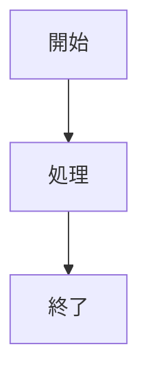

# Zenn記事執筆スキル

このスキルはZennの技術記事執筆を支援します。

## 記事ファイルの配置

- 記事ファイル: `articles/` ディレクトリに配置
- 画像ファイル: `images/` ディレクトリに配置
- ファイル名: スラッグとして使用される（例: `my-article.md` → `zenn.dev/username/articles/my-article`）

## 記事のフロントマター形式

```yaml
---
title: "記事タイトル"
emoji: "🔧"
type: "tech"  # tech または idea
topics: ["topic1", "topic2", "topic3"]  # 最大5つ
published: false  # true で公開、false で下書き
---
```

### フィールド説明

| フィールド | 必須 | 説明 |
|-----------|------|------|
| title | Yes | 記事タイトル（60文字以内推奨） |
| emoji | Yes | 記事を表す絵文字（1文字） |
| type | Yes | `tech`（技術記事）または `idea`（アイデア記事） |
| topics | Yes | タグ（1〜5個、小文字英数字とハイフン） |
| published | Yes | `true`で公開、`false`で下書き |

## ファイル命名規則

- 英小文字、数字、ハイフンのみ使用
- 12〜50文字程度
- 内容を端的に表すスラッグ
- 例: `ai-driven-e2e-testing-guide.md`

## 記事構成のベストプラクティス

### 推奨構成

1. **はじめに** - 記事の目的・対象読者・解決する課題
2. **前提/準備** - 必要な環境・知識
3. **本編** - 複数セクションに分けて詳細を説明
4. **まとめ** - 要点の整理・次のステップ
5. **参考情報** - 出典・関連リンク

### 執筆ガイドライン

- 1記事は200〜400行程度を目安に
- 見出しは `##` から開始（`#` はタイトル用に予約）
- コードブロックには言語を明記
- 長いコードは説明を挟みながら分割
- 画像は `` 形式

## コマンド

### 新規記事作成

```bash
npx zenn new:article --slug <スラッグ名>
```

### プレビュー

```bash
npx zenn preview
```

### 記事一覧確認

```bash
ls articles/
```

## 画像の配置

```
images/
└── <article-slug>/
    ├── image1.png
    └── image2.png
```

記事内での参照:
```markdown

```

## よく使うMarkdown拡張

### メッセージ

```markdown
:::message
これは通常のメッセージです
:::

:::message alert
これは警告メッセージです
:::
```

### アコーディオン

```markdown
:::details タイトル
折りたたまれる内容
:::
```

### 数式（KaTeX）

```markdown
$$
e^{i\pi} + 1 = 0
$$
```

### Mermaid図

````markdown

````

## 執筆時のチェックリスト

- [ ] タイトルは内容を端的に表しているか
- [ ] 絵文字は記事内容に合っているか
- [ ] topicsは適切か（最大5つ）
- [ ] 前提条件・対象読者は明確か
- [ ] コードブロックに言語指定があるか
- [ ] 見出し階層は適切か
- [ ] 誤字脱字はないか
- [ ] リンクは有効か
