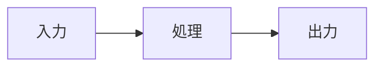

# Zenn記事執筆スキル

Zennの技術記事執筆を支援するスキル。

---

## 執筆スタイル

| 項目 | 設定 |
|------|------|
| 対象読者 | 中級〜上級エンジニア、技術に興味ある人 |
| 文体 | 丁寧だが堅すぎない（です・ます調、親しみやすさも意識） |
| 長さ | 短め（必要な情報だけを簡潔に） |
| コード/説明 | バランス型（コードブロックごとに解説を挟む） |
| 図解・画像 | 積極的に使う |
| 重視 | 再現性（読者が同じことをできる） |

---

## 文体ガイドライン

### 基本ルール

- 一文一義（1文に1つのメッセージ）
- 一文は50文字程度を目安に
- 結論から書く
- 主語と述語を明確に
- 不要な接続詞は削除

### 文体サンプル

```
この記事では、Claude CodeとMCPを組み合わせたE2Eテストの手法を紹介します。
従来のE2Eテストでは環境構築に時間がかかりがちですが、
この方法なら1コマンドで実行できます。
```

### 専門用語の扱い

専門用語には注釈をつける。

```markdown
MCP（Model Context Protocol）を使って、AIがブラウザを操作します。
```

または脚注を使う:

```markdown
MCPを使ってAIがブラウザを操作します[^1]。

[^1]: MCP（Model Context Protocol）はAIと外部ツールを接続するプロトコル。
```

---

## 記事構成テンプレート

```markdown
---
title: "タイトル"
emoji: "🔧"
type: "tech"
topics: ["topic1", "topic2"]
published: false
---

## この記事でできること

<!-- 端的に何ができるようになるか。3行以内 -->

## 前提

<!-- 必要な環境・知識。箇条書きで簡潔に -->

## 手順

<!-- 本編。再現できるよう具体的に -->

### ステップ1: ○○

<!-- コードと説明をバランスよく -->

### ステップ2: ○○

## まとめ

<!-- 箇条書きで要点を整理 -->

- ポイント1
- ポイント2
- ポイント3

## 参考

<!-- 根拠となるドキュメント・出典 -->

- [公式ドキュメント](URL)
- [参考記事](URL)
```

---

## タイトル生成（サブエージェント使用）

記事のタイトルを決める際は、Taskツールで以下のプロンプトを実行する:

```
Zennで人気の技術記事のタイトルを分析し、以下の記事内容に最適なタイトルを5案提案してください。

【分析観点】
- 数字を含むタイトルの効果
- 「〇〇してみた」「〇〇する方法」などのパターン
- 具体性と興味を引くバランス
- 対象読者（中級〜上級エンジニア）への訴求

【記事内容】
{記事の概要をここに記載}

【条件】
- 60文字以内
- 内容を端的に伝える
- クリックしたくなる要素を含める
```

---

## コードブロックのルール

### 必須事項

- **動作確認済みのコードのみ掲載する**
- 言語を必ず明記
- 長いコードは分割して説明を挟む

### 良い例

```typescript
// ユーザー情報を取得する関数
async function getUser(id: string): Promise<User> {
  const response = await fetch(`/api/users/${id}`);
  return response.json();
}
```

上記の関数は、指定されたIDのユーザー情報をAPIから取得します。

### 悪い例

```
// 長いコードを説明なしで一気に掲載
// 読者は何がポイントかわからない
```

---

## 図解・画像の使い方

### 積極的に使う場面

- アーキテクチャの説明
- 処理フローの説明
- UIの操作手順
- 複雑な概念の可視化

### 画像の配置

```
images/
└── {article-slug}/
    ├── architecture.png
    └── flow.png
```

記事内での参照:

```markdown

```

### Mermaid図の活用



---

## 文脈一貫性チェックリスト

記事完成後、以下を確認する:

### 構成の一貫性

- [ ] 冒頭で述べた「できること」が本編で実現されているか
- [ ] 前提条件で挙げた環境・知識が本編で使われているか
- [ ] まとめが本編の内容を正しく要約しているか

### 用語の一貫性

- [ ] 同じ概念に異なる用語を使っていないか
- [ ] 略語を初出時に説明しているか
- [ ] 専門用語に注釈があるか

### トーンの一貫性

- [ ] 文体が途中で変わっていないか（です/ます調の統一）
- [ ] 読者への呼びかけ方が統一されているか

### 根拠の一貫性

- [ ] 主張に根拠となるドキュメントがあるか
- [ ] 参考リンクが有効か
- [ ] 公式ドキュメントを優先しているか

---

## 参考情報の書き方

根拠となるドキュメントを原則つける。

### 良い例

```markdown
## 参考

- [Claude Code公式ドキュメント](https://docs.anthropic.com/claude-code)
- [MCP仕様](https://modelcontextprotocol.io/)
```

### インライン参照

```markdown
[公式ドキュメント](URL)によると、この機能は〜です。
```

---

## ファイル配置

- 記事: `articles/` ディレクトリ
- 画像: `images/{article-slug}/` ディレクトリ
- ファイル名: 英小文字、数字、ハイフンのみ（12〜50文字）

## コマンド

```bash
# 新規記事作成
npx zenn new:article --slug <スラッグ名>

# プレビュー
npx zenn preview
```

---

## Zenn Markdown拡張

### メッセージボックス

```markdown
:::message
補足情報
:::

:::message alert
注意事項
:::
```

### アコーディオン

```markdown
:::details 詳細を見る
折りたたまれる内容
:::
```
